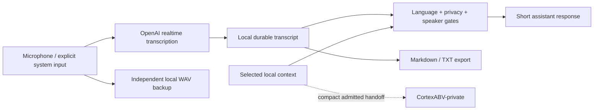

# CoqPi

<p align="center">
  
</p>

<p align="center">
  A private desktop copilot for multilingual calls, interview practice, meeting transcription, and reviewed follow-up.
</p>

<p align="center">
  <a href="https://github.com/markoblogo/CoqPi/actions/workflows/ci.yml"></a>
  <a href="https://github.com/markoblogo/CoqPi/releases/latest"></a>
  <a href="LICENSE"></a>
  
</p>

> **MVP:** CoqPi is useful for local preparation and transcription, but it has not yet completed repeated real-call latency and speaker-attribution validation.

### Compact communication workspace

The current source opens with three modes: Conversation, Recorder and Learning.
Conversation setup explicitly chooses headphones plus a separate call-audio input,
or a single-input loudspeaker conversation. The active call has no navigation,
branding or timers: small Russian meaning, a large answer and Stop. Manual ME/Space
control is available only for the single-input route. Preparation, knowledge and
settings remain reachable before starting, without Finder/mail in the main navigation.

The default window is 640x320 (minimum 400x260). Settings separate Audio,
Conversation, Recording, My data and Connection; technical tools are collapsed.
The compact build was installed locally after short
real BlackHole/OpenAI EN/FR, language-switch and persistence checks. Long-call and
physical-headset acceptance remain open. See the [real-user acceptance report](docs/audits/2026-10-23/REAL_USER_TEST_REPORT.md)
for actual audio evidence, synthetic regressions and outstanding scenarios.

Live brief replies request only the displayed translation and answer. The scheduler
uses 250 ms settling and overlaps it with cooldown, without bypassing cooldown or
stale-response guards. Short real EN/FR probes measured roughly 3-5 seconds to a
complete answer (about 4-5 seconds in the clean-input probes); this is not a long-call latency guarantee.
OpenAI brief replies now stream translation and answer text into the current request's
UI before final completion. Stop/context changes cancel that request and hide its
partial text. Only validated final output is stored as an assistant result.
First-text timing and full-answer timing are distinct; model comparisons remain open.

### Interview answer safety

Learning now includes a [complete bounded virtual interview](docs/VIRTUAL_INTERVIEW.md):
five spoken EN/FR questions, real Live hints, microphone answers, independent WAV
backup, incremental transcript and saved timings. Fictional context is isolated
from personal CVs and approved replies. After Stop, **Voice answer review** can
send one explicitly selected microphone clip to OpenAI for tentative audio-backed
feedback, replay the recording and speak a correct example. Confirm/Dismiss stays
local. **Repeat & compare** saves a separate short attempt, rechecks the original
recommendation and compares audio only after explicit consent. Identical audio,
unconfirmed advice or insufficient evidence cannot count as improvement; model
feedback remains experimental. No automatic mistake promotion or pronunciation score. Submitted-CV voice
rehearsal remains a future pass. See [audio review](docs/INTERVIEW_AUDIO_REVIEW.md).

EN/FR brief responses distinguish owner facts from interviewer assertions and
proposed commitments. Recognized high-risk questions (work authorization,
availability, accepting terms, asserted achievements and missing behavioral
examples) receive a conservative local clarification instead of a fabricated
answer. This is deliberately not a universal semantic safety guarantee.

If a model answer takes more than 1.8 seconds, the existing answer area can show
a rotating EN/FR thinking phrase. It disappears on answer, Stop, error or ME speech
and is never persisted as an assistant answer. Typical interview structures guide
generation. A local EN/FR personal answer bank in Prepare now reuses explicitly
reviewed answers for exact approved question variants, without a model request.
Profile or selected-context changes invalidate approval; new constraints fall
back to normal analysis. Personal drafts remain outside Git. See
[personal answer bank](docs/PERSONAL_REPLY_BANK.md) and
[content safety checks and limits](docs/INTERVIEW_CONTENT_SAFETY.md).

Conversation transcription uses a 500 ms end-of-speech pause; recorder mode and
the separate ME channel retain 800 ms. Explicit system audio bypasses microphone
echo/noise/gain processing. The transcription model, auto language switching and
independent audio backups are unchanged. See the [STT latency checks](docs/audits/2026-10-23/STT_LATENCY.md);
shorter VAD pauses do not guarantee bounded cloud recognition latency.

### Recording reliability

- Stop/Reset invalidates pending assistant responses; delayed answers cannot reappear in the next conversation.
- Audio capture starts before cloud transcription and continues through STT failures. Transcribe also records locally without an API key; use Recover later for text.
- An explicitly selected loopback input now feeds Live as `OTHER`; the separate microphone feeds `ME`, which is recorded but excluded from suggestions. With both sources enabled, two cloud transcription streams are used.
- Each acknowledged PCM chunk is synced locally with a usable WAV header. Recover can repair interrupted recordings and saves recovered text chunk by chunk.

See [recording reliability and setup](docs/RECORDING_RELIABILITY_033.md). Hardware routing, recognition accuracy and long-call latency still require real-call checks. These changes are included in v0.3.4.

## What it does

CoqPi keeps the communication loop in one desktop app:

- **Live** transcribes an active microphone, follows EN/FR/RU/UK language changes, and prepares one short response.
- **Transcribe** records a plain local meeting transcript without assistant analysis.
- **Training** offers a five-question virtual interview with Live hints, voice answers, recording and timings; existing text rehearsal and language correction remain available. Audio pronunciation assessment, adaptive follow-ups and submitted-CV voice rehearsal remain in the [training plan](docs/TRAINING_REHEARSAL_PLAN.md).
- **Prepare** builds a reviewed session brief from explicitly selected context.

Finder, Gmail/Calendar and Monitor integrations remain legacy/optional backend
capabilities, not primary modes. No stored data or approval boundaries have been
removed; this release focuses on communication, recording and learning.

With separate microphone and system inputs, your microphone is **ME** and call
audio is **OTHER**. For shared speakerphone input, hold Space in the focused Live
window or toggle **Говорю я**. ME remains recorded but excluded from suggestions.

## Privacy and authority

CoqPi is local-first, but OpenAI-backed transcription and assistant features send the selected audio or prompt context to OpenAI.

- Secrets stay in the Electron main process and may be stored with macOS secure storage.
- Runtime profiles, transcripts, context packs, receipts, and OAuth tokens stay outside the Git repository.
- Assistant requests pass through a local privacy gate that redacts recognized contact/tracking data and blocks secret-like material.
- Recovered transcript chunks are visibly marked before export; weak chunks can be excluded/restored for Markdown/TXT or merged into the previous segment without deleting the local session record.
- Gmail sending and Calendar creation require explicit, hash-bound user approval.
- The Monitor bridge is disabled by default, requires explicit client-speech permission, keeps its token in macOS secure storage, and never sends `ME`, partial, or system transcript items.
- CoqPi cannot autonomously join calls, control other apps, send messages, or publish content.
- CortexABV handoff accepts compact, reviewed artifacts only; raw transcripts and cross-tenant promotion remain denied.

See [Cortex context contract](docs/CORTEX_CONTEXT_CONTRACT.md) and [agent operations contract](docs/AGENT_OPERATIONS_CONTRACT.md).

## Install the latest macOS build

The current public build targets Apple Silicon Macs.

1. Open [the latest release](https://github.com/markoblogo/CoqPi/releases/latest).
2. Download `CoqPi-<version>-arm64.zip` and `SHA256SUMS.txt`.
3. Verify the checksum, extract the archive, and move `CoqPi.app` to Applications.
4. Because the app is unsigned, open it with right click → **Open** when macOS asks.

Replacing the app does not remove local data under `~/Library/Application Support/coqpi`.

## Run from source

Requirements:

- Node.js 22.12 or newer;
- pnpm 11;
- macOS for the packaged desktop app;
- an OpenAI API key for realtime transcription and OpenAI assistant responses.

```bash
git clone https://github.com/markoblogo/CoqPi.git
cd CoqPi
pnpm install
cp .env.example .env
pnpm dev
```

Set `OPENAI_API_KEY` in `.env`, or save it through Settings. Never commit the key.

The source default fast-response model is `gpt-5.6-luna`; realtime transcription
defaults to `gpt-4o-transcribe`. Backend environment overrides can select different
models; recorded measurements apply only to the actual tested configuration.

## First useful test

1. Open **Learning -> Virtual interview**, choose EN/FR and start the fictional five-question exercise.
2. Check the answer, language, model, and latency.
3. Open **Transcribe**, select the microphone and language, and record a short local sample.
4. Stop the sample. If finalized text is missing but the audio backup completed,
   use **Recover** before export.
5. Export it and confirm that the Markdown/TXT file contains the expected finalized text.
6. Only then try a short Live call.

For the real-provider checklist, use [Realtime smoke test](docs/REALTIME_SMOKE_TEST.md). For storage and recovery, use [Meeting transcription mode](docs/MEETING_TRANSCRIPTION_MODE.md).

## Speaker controls

- Hold **Space** before speaking while CoqPi is focused; release it when finished.
- Use **Говорю я** for longer answers or while switching to Meet/Zoom.
- Stop the session before reviewing or exporting it.

These controls apply to shared-input conversations, not the separate-source mode.
There is no voice biometrics. If both speakers share one uninterrupted item,
CoqPi conservatively excludes that item from suggestions. See [Manual speaker mode](docs/MANUAL_SPEAKER_MODE.md).

## Architecture



Electron main owns secrets, filesystem access, provider calls, and narrow IPC handlers. React renders the operator surfaces. Simple Assistant uses only the selected Markdown profile, selected scenario, and recent transcript; the legacy retrieval path remains available separately.

Read [Architecture](docs/ARCHITECTURE.md) for the full data flow and [Conversation delivery order](docs/CONVERSATION_DELIVERY_PLAN.md) for current acceptance gaps.

## Verification

```bash
pnpm check
```

The gate checks:

- no runtime/private data is tracked;
- TypeScript and ESLint;
- the complete deterministic Node test suite;
- renderer and Electron builds;
- high-severity dependency advisories.

The Electron UI harness and real microphone test are separate because they require a graphical macOS session:

```bash
pnpm test:conversation-ui
pnpm test:pass2-live-smoke-readiness
```

## Current limits

- Apple Silicon macOS build only; the app is unsigned and not notarized.
- Microphone input is the default capture path. A separate **System backup**
  input can be selected when macOS exposes a virtual/routed call-audio device
  such as BlackHole or Loopback; CoqPi stores that source as `system.wav`.
- Raw-audio backup writes local WAV/PCM files next to the transcript manifest.
  Stopped sessions can be manually recovered into timestamped journal chunks
  without duplicating a previous recovery, and recovery reports show recovered,
  failed, skipped, and empty chunks.
- Speaker attribution follows explicit sources; shared-input marking cannot split one mixed speech item.
- Monitor live preview depends on a selected client, an authenticated Monitor account, and correct manual `ME`/`OTHER` marking; it never creates or sends an operational BID/OFFER/TRADE.
- Live quality and p50/p95 response latency still need repeated real-call measurement.
- Local Ollama can provide controlled text fallback, but there is no offline realtime STT.

## Documentation

- [Architecture](docs/ARCHITECTURE.md)
- [Conversation delivery order](docs/CONVERSATION_DELIVERY_PLAN.md)
- [Realtime smoke test](docs/REALTIME_SMOKE_TEST.md)
- [Meeting transcription](docs/MEETING_TRANSCRIPTION_MODE.md)
- [CortexABV boundary](docs/CORTEX_CONTEXT_CONTRACT.md)
- [v0.3.4 release and verification](docs/releases/v0.3.4.md)
- [Security policy](SECURITY.md)
- [Contributing](CONTRIBUTING.md)
- [Changelog](CHANGELOG.md)

## License

[MIT](LICENSE)

<!-- ABVX:ECOSYSTEM:BEGIN -->
## ABVX ecosystem

- [AGENTS.md_generator](https://agentsmd.abvx.xyz/) — Keeps repository guidance and machine-readable context current. Current release: `v0.5.1`.
- [abvx-agent-skills](https://abvx.xyz/work/abvx-agent-skills) — Uses shared, reviewable agent capabilities during maintenance. Current release: `v0.16.1`.

_This block is generated from the reviewed ABVX ecosystem registry._
<!-- ABVX:ECOSYSTEM:END -->
